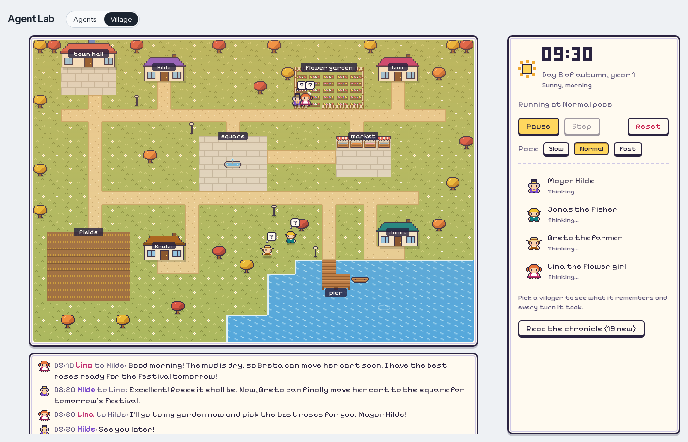
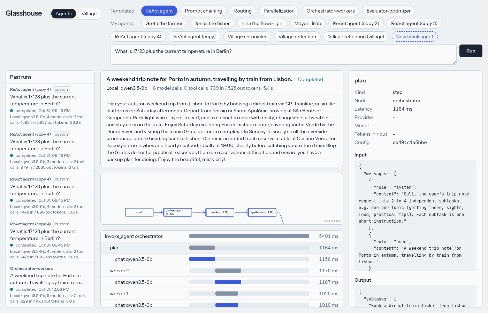
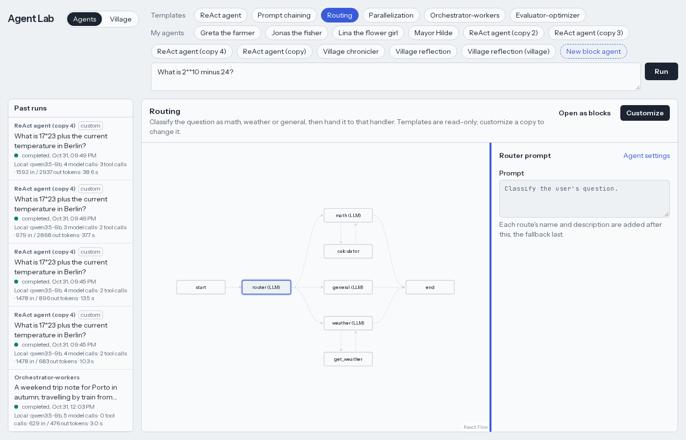
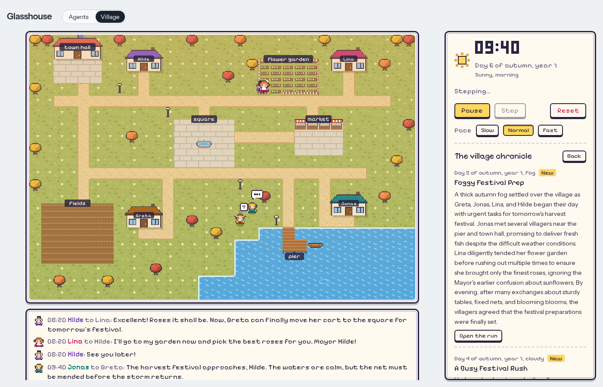
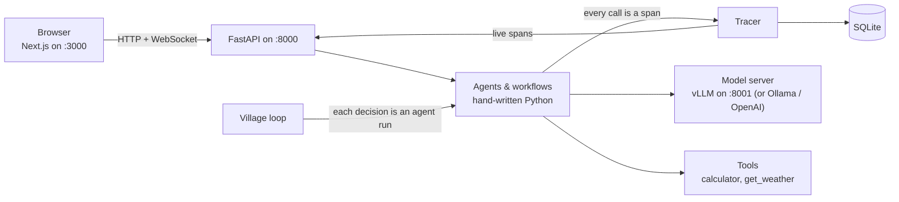

# Glasshouse

**Build AI agents by hand and watch every step they take.**

Glasshouse is a local playground for learning how agents work. No agent frameworks: the ReAct
loop, the workflow patterns, tool calling and tracing are plain, readable Python. Every model
and tool call shows up live as a span on the agent's graph, and every run can be replayed.
On top of that sits a small pixel-art village where four AI villagers live their days on their
own.

Status: a personal learning project that runs on your own machine (both servers bind to
127.0.0.1). MIT licensed.



## What you can do

| | |
|---|---|
| **Run and trace agents**<br>Pick one of six agents (ReAct plus five workflow patterns), ask something and watch the graph light up node by node. Click a span to see its prompt, answer, tokens and latency. → [docs/agents.md](docs/agents.md) |  |
| **Build your own**<br>Customize any template by clicking its nodes, or snap together a block agent (model calls, tools, checks, routers, parallel groups, loops). Saved agents run like the built-in ones. → [docs/builder.md](docs/builder.md) |  |
| **Watch a village live**<br>Four villagers plan their day, set out to do things and keep at them, work, talk face to face, remember, reflect at night and live through seasons and weather. Their work fills baskets for the harvest festival's stalls, or buys wood and paint from a daily trader; every third day they vote at the town hall on what to build next, and what they build stays on the map. A chronicler writes a diary entry every night, and **Village health** counts how they behaved each day; turn checks and scenarios measure the villagers on the real model. → [docs/village.md](docs/village.md) |  |

## How it works



- Every agent declares its graph as data; every span points at a node of it.
- Spans are saved to SQLite *and* streamed, so the live view and a replay are the same thing.
- The village never calls the model itself: each villager decision is an ordinary, traced run
  of that villager's agent, which you can open and edit.

## Quick start

You need Python 3.12 with [uv](https://docs.astral.sh/uv/), Node 22 with pnpm, and make.

```bash
make install          # backend and frontend dependencies
cp .env.example .env  # model settings
make dev-llm          # local model in Docker (needs an NVIDIA GPU, ~11 GiB VRAM; first start downloads ~11 GB)
make dev              # backend on :8000 and frontend on :3000
```

Open **http://127.0.0.1:3000**, pick an agent, press **Run**. Switch to **Village** and press
**Start** to bring the village to life.

**No GPU?** Point `.env` at any OpenAI-compatible server, e.g. Ollama
(`LLM_BASE_URL=http://localhost:11434/v1`, `LLM_MODEL=qwen3:8b`), or add OpenAI models — see
[docs/models.md](docs/models.md). The tests need no model at all.

## Check

```bash
make check   # ruff, pyright (strict), pytest, eslint, tsc, vitest — all must pass
```

## Where things are

```text
backend/src/agent_lab/
  agents/      ReAct agent, traced steps (chat, call_tool, decide), the template registry
  workflows/   chaining, routing, parallelization, orchestrator-workers, evaluator-optimizer
  blocks/      block agents: layout rules, graph, runner
  village/     map and clock, observations and actions, plans, work, trade, building, meetings, memory, seasons, chronicle, step loop
  tracing/     spans, tracer, redaction of secrets
  llm/         model client, configured models, FakeLLM for tests
  api.py       HTTP and WebSocket endpoints
frontend/src/
  app/page.tsx           the one page
  components/            run viewer, graph, builder, village
  lib/                   pure view logic, tested with vitest
specs/                   one folder per milestone: spec, plan, tasks (Spec Kit)
```

## Milestones

| | Agents | | Village |
|---|---|---|---|
| ✅ M1 | ReAct agent, tools, tracing, replay | ✅ M6 | First villagers on a map |
| ✅ M2 | Five workflow patterns | ✅ M7 | Daily life: sleep, walk, talk face to face |
| ✅ M3 | Agent builder from templates | ✅ M8 | Memories and nightly reflection |
| ✅ M4 | Model choice per agent (local, OpenAI) | ✅ M9 | Smooth motion, work animations, light |
| ✅ M5 | Block builder | ✅ M10 | Seasons, weather, growth, festival, chronicle |
| | | ✅ M11 | Plans, work and festival deliveries |
| | | ✅ M12 | Building together: a daily trader, town hall votes, building |
| | | ✅ M13 | Measuring the village: village health, turn checks, scenarios |
| | | ✅ M14 | Better villagers: intentions, what you can do here, memory by season |
| | | ⏳ M15 | Daily happenings, boat trips |

After M15 come MCP, an evaluation harness for the lab's other agents, memory for the lab's
other agents, and RAG. Each milestone's spec, plan and tasks live in `specs/`.

## More

- [docs/agents.md](docs/agents.md) — the six agents and how to read a trace
- [docs/builder.md](docs/builder.md) — customizing templates and building block agents
- [docs/village.md](docs/village.md) — how the villagers think, move, remember and live through the year
- [docs/models.md](docs/models.md) — local models, Ollama and OpenAI
- [docs/api.md](docs/api.md) — HTTP and WebSocket endpoints
- [docs/development.md](docs/development.md) — layout, rules every change follows, the Spec Kit workflow
- [AGENTS.md](AGENTS.md) — the same rules, written for coding agents

## Security and license

Found a vulnerability? Please report it privately: see [SECURITY.md](SECURITY.md).
Glasshouse is released under the [MIT License](LICENSE).
