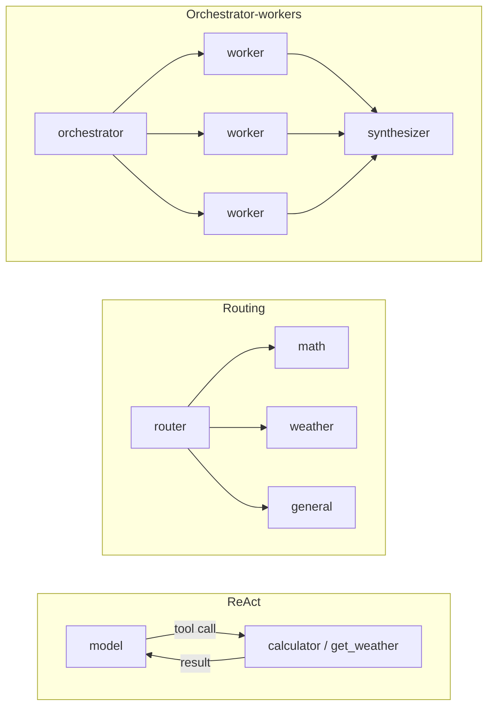
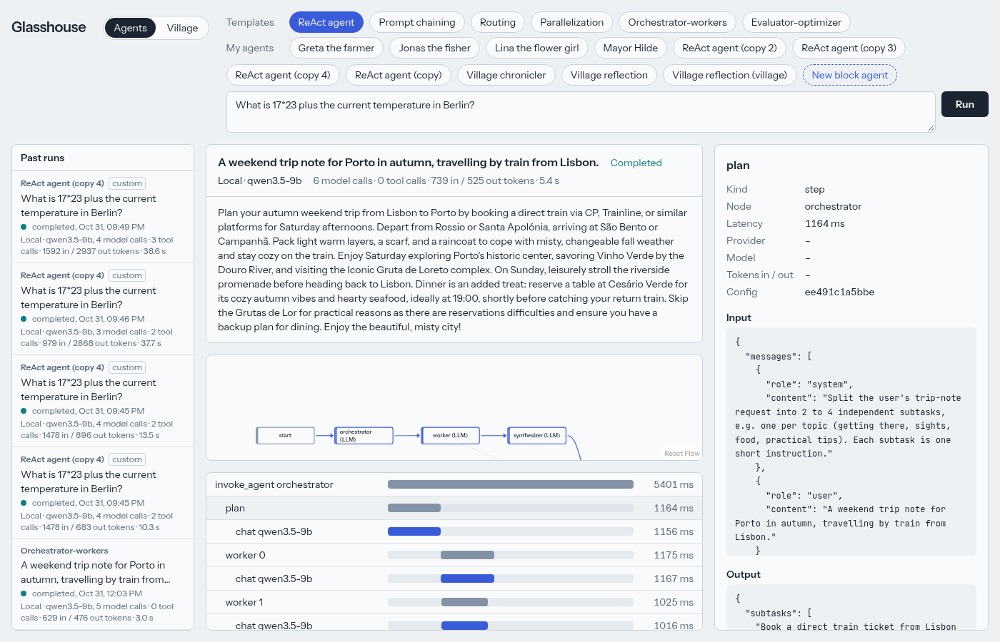

# The agents and their traces

[← README](../README.md)

Glasshouse ships six agents. They are **templates**: read-only, always on the default model.
Press **Customize** to get an editable copy ([builder.md](builder.md)).

## The six templates

| Agent | What it does | Shape |
|---|---|---|
| **ReAct agent** | Reasons, calls tools, reads their results and repeats until it can answer (up to 6 rounds). | `model ⇄ tools` |
| **Prompt chaining** | Outlines, checks, drafts and polishes a product blurb; a code gate stops the chain when the outline is too thin. | `outline → gate → draft → polish` |
| **Routing** | Classifies a question as math, weather or general and hands it to that handler. | `router → one of 3 handlers` |
| **Parallelization** | Reviews a text for clarity, tone and claims at the same time, then merges the reviews. | `3 reviews at once → merge` |
| **Orchestrator-workers** | Splits a trip-note request into subtasks at run time, works them, combines the parts. | `orchestrator → N workers → synthesizer` |
| **Evaluator-optimizer** | Writes a slogan; an evaluator approves it or sends feedback, for up to 3 rounds. | `generator ⇄ evaluator` |

Each template comes with a sample prompt, so **Run** works right away.

The lab's own tools are `calculator` (safe arithmetic) and `get_weather` (a fake, deterministic
report: the same city always gets the same weather, so runs are repeatable and need no network).
They come from the lab's own MCP server; agents can also use the notes server's tools and any
MCP server you list, named `server/tool` ([tools.md](tools.md)). A tool span shows the server
and the JSON-RPC request and response.

## Reading a run

1. **Header**: the answer, the status, which model answered, and totals (model calls, tool calls,
   tokens, wall time).
2. **Graph**: the agent's nodes. The node running now is highlighted; edges the run took are
   marked.
3. **Span waterfall**: one bar per step, nested, on a shared time axis. Parallel branches overlap.
4. **Span detail** (click a span): the exact messages sent to the model, its answer, tokens,
   latency and the config version it ran with.

Past runs (left) replay from the database exactly like a live run, because the live view and
the replay read the same stream of stored spans.

## What a span is

A span is one step: a model call, a tool call, a routing decision or a whole agent run. Spans
nest (a run contains its steps) and each one points at a node of the agent's graph. API keys
are removed from every span before it is stored or shown.
