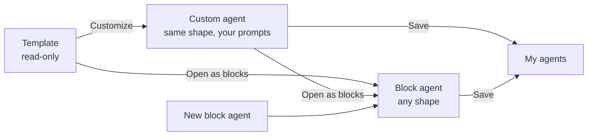
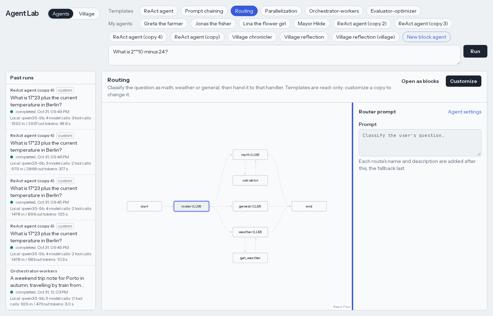

# Building your own agents

[← README](../README.md)

There are two ways to make an agent: **customize a template** (keeps its shape) or **build a
block agent** (any shape).

## Customize a template

1. Pick a template and press **Customize**.
2. Click a node to edit its prompt and settings. **Agent settings** holds the name, sample
   prompt, model, thinking on or off, and limits.
3. Change the structure the template allows; the graph redraws as you edit:
   - ReAct: which tools it may use, max rounds
   - Chaining: add, remove or reorder steps; the code gate on or off
   - Routing: routes with a name, a description and an optional tool, plus a fallback
   - Parallelization: the aspects reviewed at the same time
   - Orchestrator-workers / Evaluator-optimizer: prompts and limits
4. **Save** puts it under **My agents**. **Run** saves first. **Duplicate** and **Delete** work on
   saved agents.

Past runs keep the name, config and graph they ran with, so editing or deleting an agent never
breaks a replay.

## Block agents

A block agent is a list of blocks that run top to bottom. Edit it in the outline in the
settings panel: **+** adds a block after another, **↑ ↓** move it, **✕** removes it.

| Block | What it does |
|---|---|
| **Model call** | A system prompt and a message; optionally up to 6 tools and a limit on model calls (a ReAct loop in one block). |
| **Tool call** | One tool with its arguments. |
| **Check** | At least N bullet lines, at most N words, contains a text, or valid JSON. Failing ends the run. |
| **Router** | A model picks one of 2–6 routes; each route is its own list of blocks. |
| **Parallel group** | Fixed branches, or the same blocks once per item a model plans, all at the same time. |
| **Loop** | Repeats its blocks until a judge approves or a check passes, up to 5 rounds. |

Prompts can use placeholders:

| Placeholder | Becomes |
|---|---|
| `{input}` | the user's prompt |
| `{previous}` | the previous block's output |
| `{name}` | the output of an earlier block called `name` |
| `{feedback}`, `{item}` | inside loops and per-item groups: the judge's feedback, the current item |

Limits: up to 30 blocks, nested 3 levels deep. The server checks the layout on every save.

The villagers, the reflection agent and the chronicler are block agents too. Find them under
**My agents** and edit them like any other ([village.md](village.md)).
