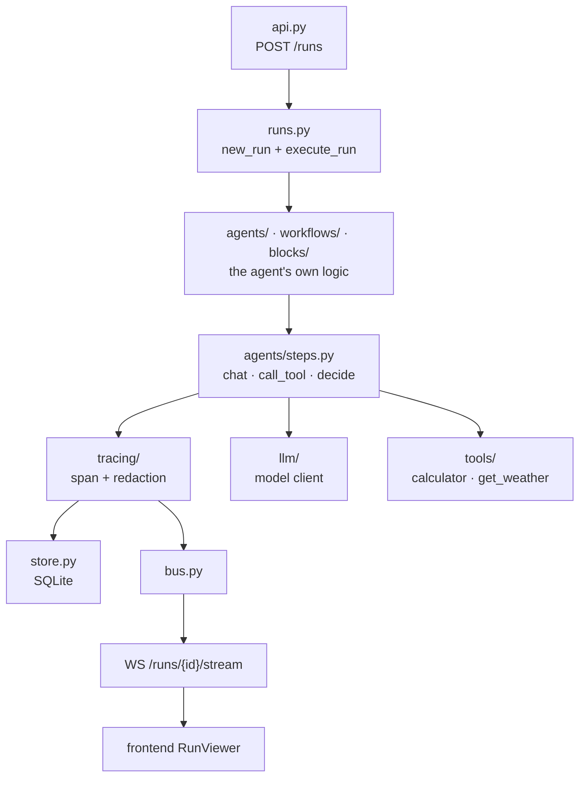
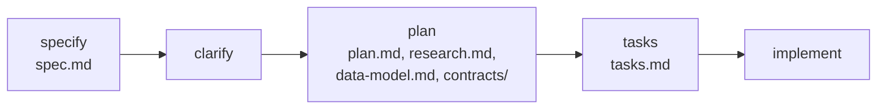

# Development

[← README](../README.md)

## Commands

```bash
make install        # uv sync + pnpm install
make dev            # backend (:8000) and frontend (:3000); Ctrl-C stops both
make dev-backend    # only the backend (reads ./.env)
make dev-frontend   # only the frontend
make dev-llm        # vLLM in Docker on :8001
make stop-llm       # remove the vLLM container
make check          # every gate; must pass before a change is done
cd backend && uv run pytest tests/test_react.py -k max_iterations   # one test
```

`make check` runs: backend `ruff check`, `ruff format --check`, `pyright` (strict), `pytest`;
frontend `eslint`, `tsc --noEmit`, `vitest run`.

## How a run flows through the code



The village sits beside it: `village/runner.py` runs the step loop and starts each villager
decision through the same `runs.py`, so every village turn is traced like any other run.

## Rules every change follows

The full set is in the [constitution](../.specify/memory/constitution.md); the short version:

- **Hand-written agent logic.** No agent frameworks (LangChain, LangGraph, CrewAI, …) and no MCP
  SDKs. Ask the owner before adding any dependency.
- **Everything is traced.** Every model and tool call goes through `agents/steps.py` and becomes
  a span on a node of the agent's declared graph.
- **Local and safe by default.** Servers bind to 127.0.0.1; API keys are redacted before any span
  is stored or streamed; model output is never executed.
- **Smallest change that works.** Build what the current milestone needs, nothing for later.
- **Tests never need a model.** They replay scripted answers with `FakeLLM`.
- **View logic lives in `frontend/src/lib/`** as pure, tested functions; components stay thin.

## The milestone workflow (Spec Kit)

Each milestone is one feature folder in `specs/`, built in fixed steps, with a commit after
each:



Every requirement maps to a test or a manual check in `tasks.md`. Real-model checks are recorded
there under "Manual check results".

## Where to look

| To change … | Look in |
|---|---|
| a template's prompts, fields or limits | `backend/src/agent_lab/workflows/*.py`, `agents/react.py` (each has a pydantic `Config`) |
| block agents | `backend/src/agent_lab/blocks/` |
| the village rules, map or villagers | `backend/src/agent_lab/village/` (`world.py`, `turn.py`, `runner.py`, …) |
| the run view | `frontend/src/components/RunViewer.tsx`, `lib/run-state.ts` |
| the builder | `frontend/src/components/AgentBuilder.tsx`, `components/builder/`, `lib/builder.ts` |
| the village view | `frontend/src/components/village/`, `lib/village.ts` |

Next.js 16 differs from older versions: read `frontend/AGENTS.md` before editing the frontend.
