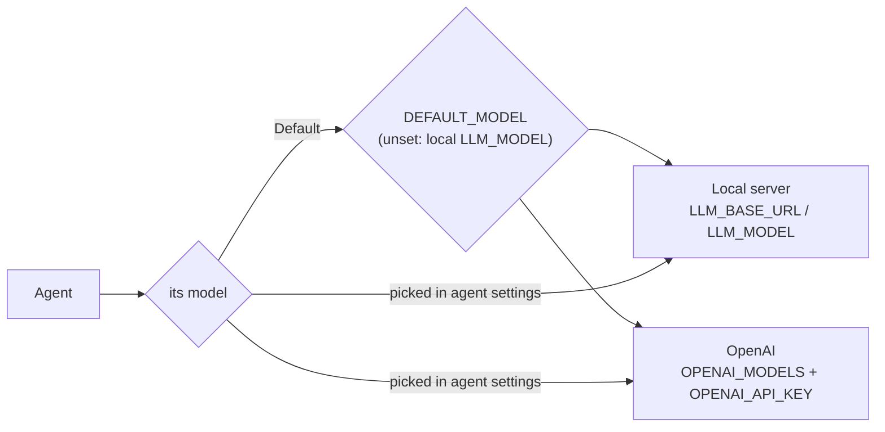

# Models

[← README](../README.md)

Agent Lab talks to any **OpenAI-compatible** chat endpoint. Settings live in `.env` (copy
`.env.example`); restart the backend after changing them.

## Pick a model server

| Option | Setup |
|---|---|
| **vLLM in Docker** (default) | `make dev-llm` serves 4-bit Qwen3.5 9B as `qwen3.5-9b` on 127.0.0.1:8001. Needs an NVIDIA GPU with ~11 GiB free and the NVIDIA container runtime; the first start downloads ~11 GB. Logs: `docker logs -f agent-lab-vllm`; remove: `make stop-llm`. |
| **Ollama** | `LLM_BASE_URL=http://localhost:11434/v1` and `LLM_MODEL=qwen3:8b` |
| **Anything else OpenAI-compatible** | set `LLM_BASE_URL`, `LLM_MODEL` and, if needed, `LLM_API_KEY` |

vLLM batches requests that arrive together, so parallel branches really run at the same time.

## Settings

| Variable | Example | What it does |
|---|---|---|
| `LLM_BASE_URL` | `http://localhost:8001/v1` | the local OpenAI-compatible endpoint |
| `LLM_MODEL` | `qwen3.5-9b` | its default model |
| `LLM_API_KEY` | *(empty)* | key for that endpoint; empty for local servers |
| `LLM_MODELS` | `qwen3:14b,llama3.3` | further models served by the same endpoint |
| `OPENAI_MODELS` | `gpt-6-luna` | OpenAI models to offer; listed but not pickable without a key |
| `OPENAI_API_KEY` | `sk-…` | enables the OpenAI models |
| `OPENAI_REASONING_OFF` | `none` | `reasoning_effort` sent when an agent's thinking is off; empty sends nothing |
| `DEFAULT_MODEL` | `openai/gpt-6-luna` | the model of templates and "Default" agents (default: the local `LLM_MODEL`); the backend refuses to start if it is not configured |
| `AGENT_LAB_DB` | `data/agent_lab.db` | the SQLite file, relative to `backend/` |

## Good to know

- Templates always run on the default model; a custom agent runs on "Default" or the model picked
  in its agent settings. The run header, past runs and span details show which model answered.
- An agent on an OpenAI model sends its prompts and tool results to OpenAI.
- Keys stay in `.env` (ignored by git), are removed from every span and are never returned by
  the API.
- Some models refuse tools while thinking (`gpt-6-luna`: "Function tools with reasoning_effort
  are not supported"); turn **Model thinking** off for tool-calling agents on them.
- The tests never use a real model: they replay scripted answers (`FakeLLM`).
