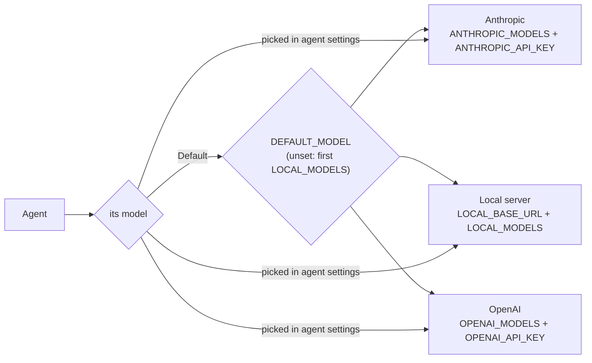

# Models

[← README](../README.md)

Glasshouse talks to **Claude** (Anthropic's Messages API) and to any **OpenAI-compatible** chat
endpoint. Both clients are written by hand in `backend/src/agent_lab/llm/`. Settings live in
`.env` (copy `.env.example`); restart the backend after changing them.

## Pick a model server

| Option | Setup |
|---|---|
| **vLLM in Docker** (default) | `make dev-llm` serves 4-bit Qwen3.5 9B as `qwen3.5-9b` on 127.0.0.1:8001. Needs an NVIDIA GPU with ~11 GiB free and the NVIDIA container runtime; the first start downloads ~11 GB. Logs: `docker logs -f agent-lab-vllm`; remove: `make stop-llm`. |
| **Ollama** | `LOCAL_BASE_URL=http://localhost:11434/v1` and `LOCAL_MODELS=qwen3:8b`; a `DEFAULT_MODEL` that names a local model must name one in `LOCAL_MODELS` (`local/qwen3:8b`) |
| **Anything else OpenAI-compatible** | set `LOCAL_BASE_URL`, `LOCAL_MODELS` and, if needed, `LOCAL_API_KEY` |

vLLM batches requests that arrive together, so parallel branches really run at the same time.

## Settings

**Switch providers with one line**, `DEFAULT_MODEL=provider/model`, then restart `make dev`:

| To use | Set |
|---|---|
| the local Qwen | `DEFAULT_MODEL=local/qwen3.5-9b` (also the default when unset) |
| OpenAI | `DEFAULT_MODEL=openai/gpt-6-luna` and `OPENAI_API_KEY` |
| Claude | `DEFAULT_MODEL=anthropic/claude-haiku-5-5` (or `…/claude-sonnet-5-5`) and `ANTHROPIC_API_KEY` |

`DEFAULT_MODEL` is the model of templates, "Default" agents and the village. A saved agent can
also be pinned to any listed model in its settings. The backend refuses to start if
`DEFAULT_MODEL` names a model that is not configured or has no key.

Each provider has the same three settings (defaults shown):

| Provider | Base URL | Models (comma-separated) | API key |
|---|---|---|---|
| `local` | `LOCAL_BASE_URL=http://localhost:8001/v1` | `LOCAL_MODELS=qwen3.5-9b` | `LOCAL_API_KEY` (empty for local servers) |
| `openai` | `OPENAI_BASE_URL=https://api.openai.com/v1` | `OPENAI_MODELS=gpt-6-luna` | `OPENAI_API_KEY` |
| `anthropic` | `ANTHROPIC_BASE_URL=https://api.anthropic.com/v1` | `ANTHROPIC_MODELS=claude-haiku-5-5,claude-sonnet-5-5` | `ANTHROPIC_API_KEY` |

Models of a provider without a key are listed as unavailable. Other settings:

| Variable | Example | What it does |
|---|---|---|
| `ANTHROPIC_WORKSPACE_ID` | `wrkspc_…` | only for an Anthropic key not scoped to a workspace: the workspace to use (sent as `anthropic-workspace-id`) |
| `OPENAI_REASONING_OFF` | `none` | `reasoning_effort` sent when an agent's thinking is off; empty sends nothing |
| `AGENT_LAB_DB` | `data/agent_lab.db` | the SQLite file, relative to `backend/` |

The names `LLM_PROVIDER`, `LLM_BASE_URL`, `LLM_MODEL`, `LLM_MODELS` and `LLM_API_KEY` were
replaced by the `LOCAL_*` settings; the backend refuses to start while one is still set and says
what replaces it.

## Good to know

- Templates always run on the default model; a custom agent runs on "Default" or the model picked
  in its agent settings. The run header, past runs and span details show which model answered.
- An agent on an OpenAI or Claude model sends its prompts and tool results to that provider.
  The village uses the default model too, so a running village on Claude costs money every turn.
- **On Claude**, the lab sends:
  - adaptive thinking with summaries shown in the trace; with **Model thinking** off, thinking
    disabled on Haiku 5.5, and Sonnet 5.5's lowest setting (`between_tools`), since Sonnet 5.5
    cannot turn thinking off completely;
  - effort `medium` and at most 16,000 output tokens per call;
  - on Sonnet 5.5, server-side fallback: a request Claude declines for some safety reasons is
    answered by the fallback model, and the span's model shows which one answered. Haiku 5.5 has
    no fallback. Any other decline ends the run with an error;
  - Claude's thinking blocks back unchanged with the tool calls they led to, as the API requires.
- There are no retries yet: a rate limit or busy server ends the run with an error (M17).
- Keys stay in `.env` (ignored by git), are removed from every span and are never returned by
  the API.
- Some models refuse tools while thinking (`gpt-6-luna`: "Function tools with reasoning_effort
  are not supported"); turn **Model thinking** off for tool-calling agents on them.
- The tests never use a real model: they replay scripted answers (`FakeLLM`).
