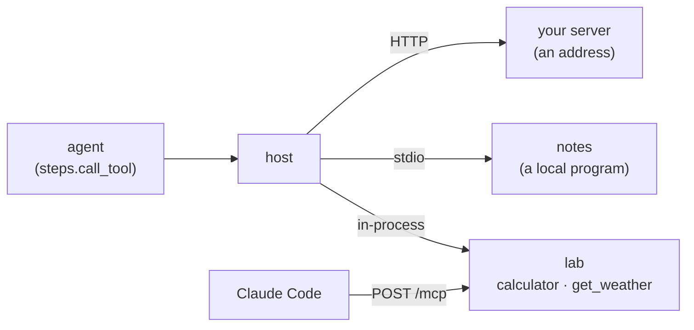

# Tools over MCP

[← README](../README.md)

Agents get their tools from MCP servers. The lab speaks the
[Model Context Protocol](https://modelcontextprotocol.io) by hand. It has no MCP library, and the
code is in `backend/src/agent_lab/mcp/`. The lab is both ends at once:

- **A host**: it connects to the servers you list and offers their tools to its agents.
- **A server**: `calculator` and `get_weather` are served by the lab's own MCP server. The lab's
  agents reach them through the host like any other tool, so every tool call takes the same
  path. Other MCP clients can use them too.



## The servers file

The lab reads the servers file at start. It uses the first one of these that exists:

1. the file named by `MCP_SERVERS_FILE`;
2. `backend/data/mcp.json`: your own file, which git ignores, so it can hold keys;
3. `backend/mcp.json`: the committed default, which lists only the notes server.

The file has the `mcpServers` shape other MCP clients use, so you can paste entries from their
docs:

```json
{
  "mcpServers": {
    "notes": {
      "command": "uv",
      "args": ["run", "--no-sync", "python", "-m", "agent_lab.mcp.notes", "--folder", "data/notes"]
    },
    "docs": {
      "url": "http://127.0.0.1:9000/mcp",
      "headers": {"Authorization": "Bearer ${DOCS_TOKEN}"}
    }
  }
}
```

**Local programs** (`command`, `args`, `env`): the lab starts the program and speaks to it over
stdin and stdout.
- The program gets only `PATH`, `HOME` and the variables in its `env`.
- It runs in the `backend/` folder.
- When the lab stops, the program is stopped too.

**Addresses** (`url`, `headers`, `allowHosts`): the lab reaches them over streamable HTTP.
- Only addresses on this computer (`127.0.0.1`, `localhost`, `::1`) are allowed, unless the
  entry lists the host in `allowHosts`.
- Servers that need a sign-in (OAuth) are not supported. A fixed header with a key works.

**Secrets**: `${NAME}` in an `env` or `headers` value is taken from the lab's environment, which
`make dev` loads from `.env`. Every such value is redacted from spans, from runs and from the
Tools page.

**Rules**:
- Server names use lowercase letters, digits and `-` (at most 30 characters).
- `lab` is reserved for the lab's own server.
- The file may list at most 20 servers.
- An unknown field is refused, so a typo is reported rather than ignored.

## The Tools page

Open the **Tools** tab next to Agents and Village. For each server it shows:
- its kind (built in, local program or address), its command or address, and its state:
  connecting, connected, or failed with the reason;
- the protocol revision and the server's own name and version;
- its tools, with their descriptions and arguments;
- the messages of its last connect (*Last connect*), with secrets redacted.

**Reload** re-reads the file: new and changed entries connect, and removed ones close.
**Reconnect** connects one server again, for example after you fixed its entry.

A server that fails never keeps the lab from starting. The lab's own tools always work.

## Naming tools

| Who | Name |
|---|---|
| configs and pickers | `calculator`, `get_weather` (the lab's; `lab/calculator` works too), or `server/tool`, e.g. `notes/write_note` |
| the model | the tool's own name if it is unique among the tools offered and uses only letters, digits, `_` and `-`; otherwise `server__tool`, made safe and unique |

Agents saved before M16 keep working unchanged. A model-call block may offer up to 6 tools.

Whether a server offers a tool is checked when a run starts. If one is missing, the run is
refused (`409`) with the reason, for example `server "notes" is not connected`. You can save an
agent while its server is down.

## What the model gets back

- **Text**: the tool's text is passed back as a tool result, never as an instruction.
- **Long results**: text past 20,000 characters is cut, with a note saying how much was cut.
- **Non-text content** is replaced by a placeholder, such as `[image: image/png]`.
- **Errors** become the tool's result text, starting with `error: `, and the run goes on. This
  covers a tool error, a call with no answer within 30 seconds, and a server that went away.
  The span is marked as an error.
- **Connecting**: a server that does not finish connecting within 10 seconds fails.

Every tool call is a tool span with these attributes:
- `lab.mcp.server`, `mcp.protocol.version` and `jsonrpc.request.id`;
- `lab.mcp.request` and `lab.mcp.response`: the JSON-RPC request and response as they were sent
  and received.

## The notes server

`python -m agent_lab.mcp.notes --folder PATH` is a small MCP server written the same way as the
lab's own. It keeps short notes as files in one folder. The default file runs it with
`data/notes` (`backend/data/notes/`, which git ignores).

| Tool | What it does |
|---|---|
| `list_notes` | the saved notes with their sizes |
| `read_note(name)` | one note's text |
| `write_note(name, text)` | creates or replaces a note |

Its limits:
- note names use letters, digits, spaces, `_` and `-` (at most 60 characters);
- a note holds at most 20,000 characters, and the folder at most 200 notes;
- it never reads or writes outside its folder, even through a link.

## Two protocol revisions

The lab speaks MCP **2026-07-28**. That revision has no handshake: a client asks
`server/discover`, and every request carries its protocol version. For a server that does not
understand `server/discover`, the lab falls back to **2025-11-25** (`initialize`) and older
revisions back to 2024-11-05. The lab's own server and the notes server answer both
revisions.

The lab follows a server's tool changes (`notifications/tools/list_changed`), except for an
older-revision server reached over HTTP. For those, the Tools page says so; press Reconnect.

## Using the lab's tools from Claude Code

The lab's own server is at `POST http://127.0.0.1:8000/mcp`. While `make dev` runs:

```bash
claude mcp add --transport http glasshouse http://127.0.0.1:8000/mcp
```

Claude Code can then call `calculator` and `get_weather`. The endpoint refuses web pages from
other sites (any browser `Origin` other than the lab's own) and has no sessions or streams.
