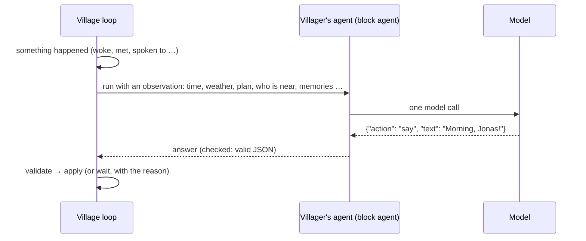
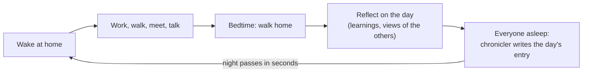

# The village

[← README](../README.md)

Switch the header to **Village** and press **Start**. Four villagers live on a small map, each
with a house next to its work and its own sleeping hours. Leave the tab open and look back
later: they will have met, talked, worked and remembered.

| Villager | Works at | Up / to bed | Character |
|---|---|---|---|
| **Mayor Hilde** | town hall | 07:30 / 23:00 | Sociable, a little self-important; plans the harvest festival |
| **Jonas the fisher** | pier | 05:00 / 21:00 | Quiet, then tells long stories about the lake |
| **Greta the farmer** | fields | 05:30 / 21:30 | Practical, worries about the weather and the harvest |
| **Lina the flower girl** | flower garden | 06:30 / 22:00 | Cheerful and curious, passes on everyone's news |

## How a villager decides

The clock moves in steps of 10 village minutes. A villager only thinks when something happens:
it woke up, arrived, met someone, was spoken to, found (or missed) someone, or half an hour
passed.

A villager can **move** to a place (or the building site), **find** someone where it thinks
they are, **say** something to someone right next to it, say **goodbye** (and where it goes
next), **work** where it stands, **give** what it carries to someone (or onto the festival stalls,
or down at the building site), **buy** building goods from the trader or **wait**. Anything invalid becomes a wait, and the
reason is recorded. Every decision is an ordinary
traced run: click a villager, then a turn, to see the exact prompt and answer.

Villagers only talk face to face and stay together until one says goodbye. Each keeps its own
idea of where the others are (seen, heard, or their usual routine), which can be out of date.

The observation puts **what a villager knows for sure** (the date and the real weather, where it
is, its plan, who is next to it) before **what others told it**, which is marked as claims that
may be wrong. The rules tell villagers to trust what they see over what they hear, and the
chronicler never reports a claim as an event.

A villager is shown its last three lines, and a line that repeats one of them (ignoring case,
spaces and punctuation) is refused with "you already said that". A goodbye that repeats a line
still ends the conversation, just without the words.

## Plans and purpose

- **Daily plans**: when a villager wakes, the shared **Village planner** agent writes its plan for
  the day: two to six entries, each a time, a place or someone to see, and a purpose ("11:00 see
  Jonas: ask for fish for the stalls"). The plan is part of every decision that day, with the
  current and next entry marked, and shows under **Today's plan** in the villager panel. After a
  conversation of four lines or more, both villagers may revise their plans, at most twice a day.
- **Work**: at the fields or the flower garden anyone can work; at the pier Jonas fishes, and
  others can fish with him while he does. A villager works until it walks off or goes to bed;
  talking does not stop it. Everyone's work on a place adds up.
- **Baskets**: every village hour of work at a place fills a basket: fish at the pier, vegetables
  from ripe or harvested fields, flowers from a blooming garden. It goes to the worker who worked
  there longest with empty hands; each villager carries one basket at a time, overnight too.
- **Give**: a villager hands its basket to someone next to it, or, standing on the square, sets it
  out on the **festival stalls**. A basket never goes straight back to whoever just gave it, and
  one that arrives while a villager is deciding waits for its next decision. In autumn every
  villager is told what the stalls hold and still lack, and one carrying a basket is told to take
  it to the square and set it out; the map shows the stalls and every carried basket.

## Building together

- **The trader**: every day from 09:00 to 14:00 a trader stands at the market with wood, paint
  and saplings (a different stock each day). A villager at the market trades the basket it
  carries (fish, vegetables or flowers) for one load: there is no money, one basket buys one
  load. A villager carries one thing at a time, a basket or a load.
- **The town hall meeting**: every third day at 17:00 (the day after, when it falls on the
  festival). In the morning Hilde proposes two or three projects from the village catalogue;
  at 16:30 everyone away is called to the town hall (a talk on the way, like the walk home to
  bed, no longer holds anyone up), and everyone else who comes votes for
  one, with a reason; from 17:30, once Hilde is there, she decides.
  She usually follows the vote, but she may choose another proposal if she gives a reason, and
  everyone hears when she went against the vote. A meeting Hilde has not come to by 18:30 is
  called off; an
  unusable decision lets the vote decide, and unusable proposals or work plans are asked for
  once more.
- **The work**: Hilde then hands out the work: who buys which goods, who brings them to the
  building site, who builds. Not everyone has to help. The tasks show in the villagers' plans
  and in what they are told until the project is done; while a project is under way, the
  meeting only reviews it and may hand out the work again.
- **The building site**: villagers walk there (`"building site"`), set down their loads and
  work there. A villager carrying a load the project needs is told to take it there and set it
  down, and one standing at a site with loads is told it can build; at 17:00 on a meeting day
  everyone away is called to the town hall. Every village hour of work, added up over everyone at the site, works in one load.
  The site shows scaffolding and the loads lying there.
- **What stays**: the catalogue holds ten projects: painting the town hall or one of the four
  houses (2 paint each), young trees by the square (3 saplings), a market stand (3 wood, 1
  paint), a rowing boat by the pier (4 wood, 1 paint), and a bakehouse (14 wood, 3 paint) and a
  barn (16 wood, 3 paint) on their fenced plots, which take more than a day. A finished project
  stays on the map for good; everyone remembers it and the chronicle tells of it.
- **Village projects** (next to **Read the chronicle**) shows the project with its progress and
  tasks, the latest meeting with every proposal, vote and the decision (each opens its run), and
  what has been built.

## A day in the village

- **Memory**: every conversation, search and first meeting of the day becomes a memory (up to
  60 per villager). When deciding, a villager is reminded of the memories that matter right now:
  about who is next to it, who it is looking for and where it is.
- **Reflection**: going to bed after an eventful day, a villager writes up to three learnings
  ("Jonas is at the market around midday") and one sentence about each villager it dealt with.
  Both are part of every decision from then on.
- **Chronicle**: once everyone sleeps, the chronicler writes a diary entry about the day. If the
  entry names weather the day did not have (villagers often talk about storms that never come),
  it is asked once more.
  **Read the chronicle** shows the last 28 entries, newest first, marks the new ones and opens
  the run behind each.

## Seasons, weather and growth

- A year has four seasons of 7 days, starting in spring. Trees blossom, turn green, gold and red,
  and stand bare in winter; days are longer in summer.
- Every day has its own weather fitting the season (sun, clouds, rain, storm, fog, snow), shown
  on the map and told to the villagers.
- The **fields** grow only on days villagers work an hour on them (rain helps): tilled, sown,
  sprouting, growing, ripe, harvested in autumn. Weeds show when they are left alone.
- The **flower garden** blooms while it is worked on or rained on and wilts when it dries out.
- On the last day of autumn, Hilde's **harvest festival** decorates the square. The villagers hear
  about it for days, gather there in the evening and remember it, with what made it onto the
  stalls; the chronicle names the goods too. The stalls are cleared when winter comes.

## Controls

| Control | What it does |
|---|---|
| **Start / Pause** | Run or stop the clock. |
| **Step** | One step while paused, with the decisions it starts. |
| **Reset** | Back to day 1 of spring (the villagers' agents are kept). |
| **Slow / Normal / Fast** | A step every 15, 5 or 2 seconds: a village day takes about 28, 9 or 4 minutes. The pace never changes the model. |

The village pauses itself 60 seconds after the last Village tab closes, and after three steps
in which every decision failed (for example, the model server is down).

## Make it your own

Each villager is a block agent under **My agents**, created on the first Start. **Edit its
agent** (in the villager panel) opens it in the builder; an edit applies from its next decision.
Plans, reflections, the chronicle and the town hall meeting run on the shared **Village
planner**, **Village reflection**, **Village chronicler** and **Village meeting** agents,
editable the same way.

## What's next

- **M13 Daily happenings**: something different every day: the postman, a visiting friend, boat
  trips on the lake in the boat the village built, and whispers to villagers.
