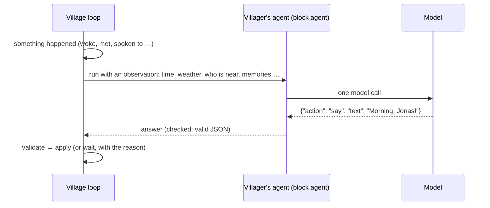
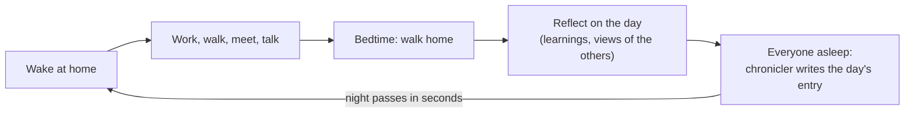

# The village

[← README](../README.md)

Switch the header to **Village** and press **Start**. Four villagers live on a small map, each
with a house next to its work and its own sleeping hours. Leave the tab open and look back
later: they will have met, talked, worked and remembered.

| Villager | Works at | Up / to bed | Character |
|---|---|---|---|
| **Mayor Hilde** | town hall | 07:30 / 23:00 | Sociable, a little self-important; plans the harvest festival |
| **Jonas the fisher** | pier | 05:00 / 21:00 | Quiet, then tells long stories about the lake |
| **Greta the farmer** | fields | 05:30 / 21:30 | Practical, worries about the weather and the harvest |
| **Lina the flower girl** | flower garden | 06:30 / 22:00 | Cheerful and curious, passes on everyone's news |

## How a villager decides

The clock moves in steps of 10 village minutes. A villager only thinks when something happens:
it woke up, arrived, met someone, was spoken to, found (or missed) someone, or half an hour
passed.

A villager can **move** to a place, **find** someone where it thinks they are, **say**
something to someone right next to it, say **goodbye** (and where it goes next) or **wait**.
Anything invalid becomes a wait, and the reason is recorded. Every decision is an ordinary
traced run: click a villager, then a turn, to see the exact prompt and answer.

Villagers only talk face to face and stay together until one says goodbye. Each keeps its own
idea of where the others are (seen, heard, or their usual routine), which can be out of date.

## A day in the village

- **Memory**: every conversation, search and first meeting of the day becomes a memory (up to
  60 per villager). When deciding, a villager is reminded of the memories that matter right now:
  about who is next to it, who it is looking for and where it is.
- **Reflection**: going to bed after an eventful day, a villager writes up to three learnings
  ("Jonas is at the market around midday") and one sentence about each villager it dealt with.
  Both are part of every decision from then on.
- **Chronicle**: once everyone sleeps, the chronicler writes a diary entry about the day.
  **Read the chronicle** shows the last 28 entries, newest first, marks the new ones and opens
  the run behind each.

## Seasons, weather and growth

- A year has four seasons of 7 days, starting in spring. Trees blossom, turn green, gold and red,
  and stand bare in winter; days are longer in summer.
- Every day has its own weather fitting the season (sun, clouds, rain, storm, fog, snow), shown
  on the map and told to the villagers.
- The **fields** grow only on days someone spends an hour on them (rain helps): tilled, sown,
  sprouting, growing, ripe, harvested in autumn. Weeds show when they are left alone.
- The **flower garden** blooms while it is watered or rained on and wilts when it dries out.
- On the last day of autumn, Hilde's **harvest festival** decorates the square. The villagers hear
  about it for days, gather there in the evening and remember it.

## Controls

| Control | What it does |
|---|---|
| **Start / Pause** | Run or stop the clock. |
| **Step** | One step while paused, with the decisions it starts. |
| **Reset** | Back to day 1 of spring (the villagers' agents are kept). |
| **Slow / Normal / Fast** | A step every 15, 5 or 2 seconds: a village day takes about 28, 9 or 4 minutes. The pace never changes the model. |

The village pauses itself 60 seconds after the last Village tab closes, and after three steps
in which every decision failed (for example, the model server is down).

## Make it your own

Each villager is a block agent under **My agents**, created on the first Start. **Edit its
agent** (in the villager panel) opens it in the builder; an edit applies from its next decision.
Reflections and the chronicle run on the shared **Village reflection** and **Village
chronicler** agents, editable the same way.

## What's next

- **M11 Plans and purpose**: a plan for each day, facts kept apart from gossip, no repeated
  lines, and work that fills baskets for the festival.
- **M12 Building together**: painting houses, planting trees, market stands, new buildings that
  take several days, boat trips.
- **M13 Daily happenings**: something different every day: the postman, a visiting friend, a
  travelling merchant …
