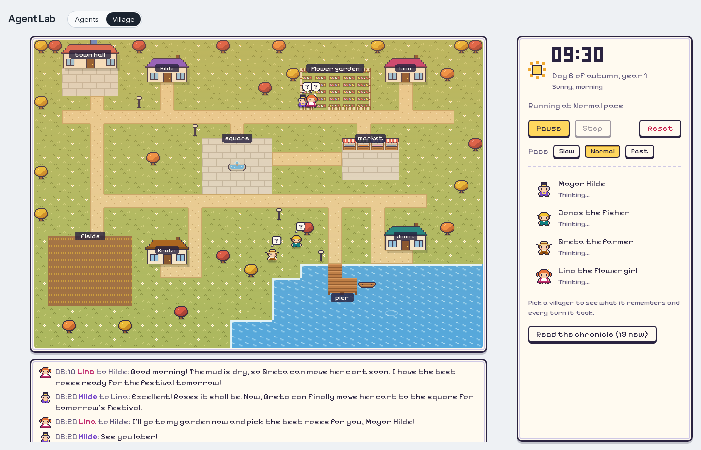
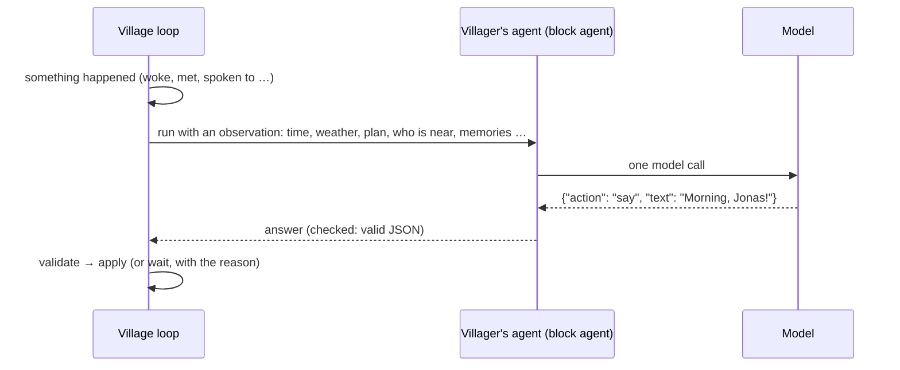
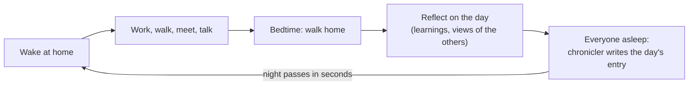
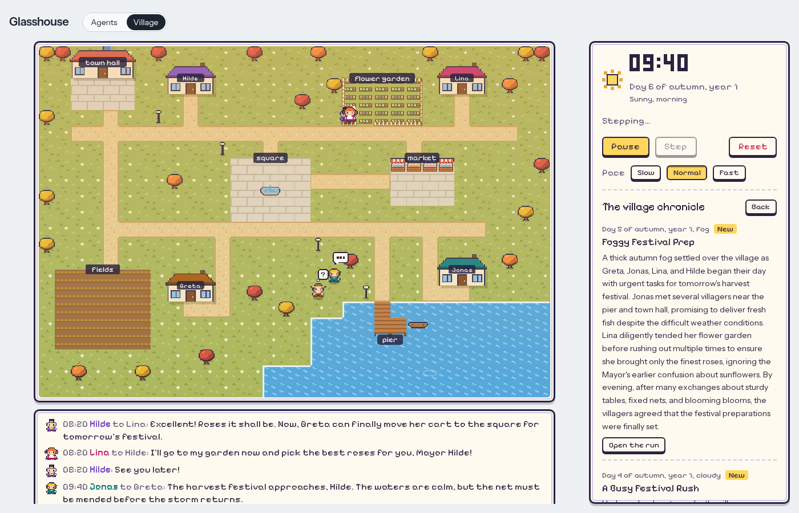

# The village

[← README](../README.md)

Switch the header to **Village** and press **Start**. Four villagers live on a small map, each
with a house next to its work and its own sleeping hours. Leave the tab open and look back
later: they will have met, talked, worked and remembered.



| Villager | Works at | Up / to bed | Character |
|---|---|---|---|
| **Mayor Hilde** | town hall | 07:30 / 23:00 | Sociable, a little self-important; plans the harvest festival |
| **Jonas the fisher** | pier | 05:00 / 21:00 | Quiet, then tells long stories about the lake |
| **Greta the farmer** | fields | 05:30 / 21:30 | Practical, worries about the weather and the harvest |
| **Lina the flower girl** | flower garden | 06:30 / 22:00 | Cheerful and curious, passes on everyone's news |

## How a villager decides

The clock moves in steps of 10 village minutes. A villager only thinks when something happens:
it woke up, met someone, was spoken to, finished or gave up what it set out to do, or, with
nothing to do, half an hour passed.



**Intentions** (M14). Some answers set a villager on something, and it keeps at it until it is
done, given up or replaced by the next one:

- **move** to a place, home or the building site;
- **work** here, or at a named place, until a time (`{"action": "work", "place": "fields",
  "until": "12:00"}`);
- **build** at the building site, until a time;
- **bring** the load it carries to the building site;
- **find** someone, with a line to say on reaching them (`{"action": "find", "villager":
  "Greta", "say": "Any vegetables?"}`).

The village takes the certain steps without asking the model: it walks there, starts the work
on arrival, sets a needed load down and says the line. The villager is asked again when the
intention ends ("you are done with: work at the fields until 12:00: it is 12:00") or something
happens. Every start and end is an event and a note for the chronicle, and the villager's panel
shows what it is **Set on**.

The other answers happen at once: **say** something to someone right next to it, say
**goodbye** (and where it goes next), **give** what it carries, **buy** building goods from the
trader, or **wait**. Anything invalid becomes a wait, and the reason is recorded. Every decision
is an ordinary traced run: click a villager, then a turn, to see the exact prompt and answer.

Each turn's facts end with **What you can do here**: up to six answers the village would accept
right now, as exact JSON with why ("the building site holds 2 saplings"). It is built from the
same checks that refuse answers, so it never offers one that would be refused, and it replaced
the hints M11 and M12 had added one by one.

Villagers only talk face to face. A say to someone in sight but further away becomes a find
that says the line on arrival; a find follows the person while they are in sight and ends next
to them, or with "you lost sight of Greta at the market". A villager that sets out elsewhere
while talking says goodbye and goes (two talkers going the same way walk on together and keep
talking). It gives what it carries only to the one it set out to see or to someone who asked
for those goods in the last hour. Each keeps its own idea of where the others are (seen, heard,
or their usual routine), which can be out of date.

The observation puts **what a villager knows for sure** (the date and the real weather, where it
is, its plan, who is next to it) before **what others told it**, which is marked as claims that
may be wrong. The rules tell villagers to trust what they see over what they hear, and the
chronicler never reports a claim as an event.

A villager is shown its last three lines, and a line that repeats one of them (ignoring case,
spaces and punctuation) is refused with "you already said that". A goodbye that repeats a line
still ends the conversation, just without the words.

## Plans and purpose

- **Daily plans**: when a villager wakes, the shared **Village planner** agent writes its plan for
  the day: two to six entries, each a time, a place or someone to see, and a purpose ("11:00 see
  Jonas: ask for fish for the stalls"). The plan is part of every decision that day, with the
  current and next entry marked, and shows under **Today's plan** in the villager panel. After a
  conversation of four lines or more, both villagers may revise their plans, at most twice a day.
- **Work**: at the fields or the flower garden anyone can work; at the pier Jonas fishes, and
  others can fish with him while he does. A villager works until it walks off or goes to bed;
  talking does not stop it. Everyone's work on a place adds up.
- **Baskets**: every village hour of work at a place fills a basket: fish at the pier, vegetables
  from ripe or harvested fields, flowers from a blooming garden. It goes to the worker who worked
  there longest with empty hands; each villager carries one basket at a time, overnight too.
- **Give**: a villager hands its basket to someone next to it, or, standing on the square, sets it
  out on the **festival stalls**. A basket never goes straight back to whoever just gave it, and
  one that arrives while a villager is deciding waits for its next decision. In autumn every
  villager is told what the stalls hold and still lack, and one carrying a basket is told to take
  it to the square and set it out; the map shows the stalls and every carried basket.

## Building together

- **The trader**: every day from 09:00 to 14:00 a trader stands at the market with wood, paint
  and saplings (a different stock each day). A villager at the market trades the basket it
  carries (fish, vegetables or flowers) for one load: there is no money, one basket buys one
  load. A villager carries one thing at a time, a basket or a load.
- **The town hall meeting**: every third day at 17:00 (the day after, when it falls on the
  festival). In the morning Hilde proposes two or three projects from the village catalogue;
  at 16:30 everyone away is called to the town hall (a talk on the way, like the walk home to
  bed, no longer holds anyone up), and everyone else who comes votes for
  one, with a reason; from 17:30, once Hilde is there, she decides.
  She usually follows the vote, but she may choose another proposal if she gives a reason, and
  everyone hears when she went against the vote. A meeting Hilde has not come to by 18:30 is
  called off; an
  unusable decision lets the vote decide, and unusable proposals or work plans are asked for
  once more.
- **The work**: Hilde then hands out the work: who buys which goods, who brings them to the
  building site, who builds. Not everyone has to help. The tasks show in the villagers' plans
  and in what they are told until the project is done; while a project is under way, the
  meeting only reviews it and may hand out the work again.
- **The building site**: villagers bring their loads there and build. What a villager can do
  with its load, the loads at the site and the trader's goods shows in its **What you can do
  here**; at 16:30 on a meeting day everyone away is called to the town hall. Every village hour
  of work, added up over everyone at the site, works in one load.
  The site shows scaffolding and the loads lying there.
- **What stays**: the catalogue holds ten projects: painting the town hall or one of the four
  houses (2 paint each), young trees by the square (3 saplings), a market stand (3 wood, 1
  paint), a rowing boat by the pier (4 wood, 1 paint), and a bakehouse (14 wood, 3 paint) and a
  barn (16 wood, 3 paint) on their fenced plots, which take more than a day. A finished project
  stays on the map for good; everyone remembers it and the chronicle tells of it.
- **Village projects** (next to **Read the chronicle**) shows the project with its progress and
  tasks, the latest meeting with every proposal, vote and the decision (each opens its run), and
  what has been built.

## Daily happenings, the boat and whispers

- **Daily happenings** (M15): every village day brings one or two of five kinds, the same each
  time that day comes:
  - a **letter**: the postman brings it to a villager's door in the morning, and the villager
    reads it at home;
  - a **visitor**: a sister, an uncle or a friend waits at a villager's door in the afternoon
    and keeps the host company;
  - a **lost animal**: it wanders to a place, and anyone next to it can take it home
    (`{"action": "lead"}`);
  - a **repair**: the fence, the pier's boards or the garden gate breaks, and the place gives
    its goods half as fast until an hour of work there mends it;
  - a **peddler**: at the square from 10:00 to 15:00, with one curiosity to trade for a basket
    (`{"action": "buy", "goods": "lantern"}`). The villager keeps it; it does not fill its hands.

  Villagers learn of a happening by seeing it, by being the one it concerns, or by being told.
  Their **What you can do here** offers the answer when there is one. Happenings are drawn on
  the map: the postman, the visitor, the animal, the peddler, a red mark on a broken thing. The
  chronicle opens each day with "Today: …" and how each happening ended.
- **Boat trips**: once the village has built its rowing boat, a villager at the pier can take
  it out (`{"action": "row", "with": "Greta"}`) for about an hour, or until a time.
  - The one asked along comes with its own `row`.
  - Fishing from the boat fills a basket twice as fast.
  - A talk in the boat lasts the trip.
  - The boat moves round the lake on the map.
  - There are no trips in a storm, and the boat is back by bedtime.
- **Whispers**: from a villager's panel you can whisper it a line of up to 200 characters, three
  a day. It hears it as a claim from "a voice", like anything else it is told, and decides what
  to do. A sleeping villager hears it on waking. The turn that answered is marked "after a
  whisper".

## A day in the village



- **Memory**: every conversation, search and first meeting of the day becomes a memory (up to
  60 per villager). When deciding, a villager is reminded of the memories that matter right now:
  about who is next to it, who it is looking for and where it is. A memory from another season
  counts for less unless it is about someone at hand, so last autumn's festival no longer fills
  summer plans (M14).
- **Reflection**: going to bed after an eventful day, a villager writes up to three learnings
  ("Jonas is at the market around midday") and one sentence about each villager it dealt with.
  Both are part of every decision from then on. Once it has more than five reflections older
  than three days, the same reflection also folds them into one summary.
- **Chronicle**: once everyone sleeps, the chronicler writes a diary entry about the day. If the
  entry names weather the day did not have (villagers often talk about storms that never come),
  it is asked once more. Notes naming other weather are marked "(talk, not the day's weather)".
  **Read the chronicle** shows the last 28 entries, newest first, marks the new ones and opens
  the run behind each.



## Seasons, weather and growth

- A year has four seasons of 7 days, starting in spring. Trees blossom, turn green, gold and red,
  and stand bare in winter; days are longer in summer.
- Every day has its own weather fitting the season (sun, clouds, rain, storm, fog, snow), shown
  on the map and told to the villagers.
- The **fields** grow only on days villagers work an hour on them (rain helps): tilled, sown,
  sprouting, growing, ripe, harvested in autumn. Weeds show when they are left alone.
- The **flower garden** blooms while it is worked on or rained on and wilts when it dries out.
- On the last day of autumn, Hilde's **harvest festival** decorates the square. The villagers hear
  about it for days, gather there in the evening and remember it, with what made it onto the
  stalls; the chronicle names the goods too. The stalls are cleared when winter comes.

## Controls

| Control | What it does |
|---|---|
| **Start / Pause** | Run or stop the clock. |
| **Step** | One step while paused, with the decisions it starts. |
| **Reset** | Back to day 1 of spring (the villagers' agents are kept). |
| **Slow / Normal / Fast** | A step every 15, 5 or 2 seconds: a village day takes about 28, 9 or 4 minutes. The pace never changes the model. |

The village pauses itself 60 seconds after the last Village tab closes, and after three steps
in which every decision failed (for example, the model server is down).

## Make it your own

Each villager is a block agent under **My agents**, created on the first Start. **Edit its
agent** (in the villager panel) opens it in the builder; an edit applies from its next decision.
Plans, reflections, the chronicle and the town hall meeting run on the shared **Village
planner**, **Village reflection**, **Village chronicler** and **Village meeting** agents,
editable the same way.

## Measuring the village

Changing a prompt or a model changes how the villagers behave, and one run says little: the
same village can finish a project or nothing at all. Three instruments show what a change does.

- **Village health** (next to **Village projects**): numbers for every village day, from what
  the village records anyway, so they cost no model call:
  - decisions and how many were waits;
  - refusals by reason, each opening its turns;
  - conversation lengths and repeated lines;
  - how well villagers kept their plans;
  - meetings, trades, loads and how long a load took to reach the site;
  - baskets given straight back, and weather the chronicle got wrong;
  - hours a villager stood stuck, and model calls.

  The day in progress is marked "so far". Days before M13 show "–" for what needs the day
  trail (where everyone was each step).
- **Turn checks** (`make eval-checks`): situations from `backend/evals/checks/`, each given to
  the real model 10 times with the kind of answer wanted (for example "carrying a load the site
  needs, at the site → set it down"). A check built from a fixture builds its prompt with
  today's code, so prompt changes are tested; a frozen check asks a recorded prompt as it was.
  Add one from any recorded turn:

  ```bash
  cd backend && uv run python -m agent_lab.village.evals add-check --run RUN_ID \
      --name not-to-hilde --expect '{"not": [{"action": "give", "to": "Hilde"}]}'
  ```
- **Scenarios** (`make eval-scenarios`): a fixed starting village, a few village hours and a
  condition (at least three at the meeting; a bought load at the site by noon; a talk that ends
  and both go on), run 5 times on fresh copies in `backend/data/evals/`. Your village is only
  read.

M14 added four checks, one per behaviour it improves: `intention-keeps-building`,
`say-to-someone-in-sight`, `leave-talk-for-intention` and `summer-plan-without-festival` (a plan
must not name the check's `"excludes"` words). The M13 checks stay as they were, as the
baseline; `load-at-site-m14` and `load-away-m14` ask the same with `"any_of"`, which also
accepts M14's answers (`bring`, or building at the site).

M15 added a check for each happening (`animal-lead`, `repair-mend`, `peddler-curiosity`,
`letter-pass-on`, `visitor-host`) and for taking the boat (`take-the-boat`), and a `boat-trip`
scenario. Village health counts each day's happenings and how many were dealt with, boat trips,
and whispers and how many were followed by an action.

Each result shows passes out of attempts with a 95% range: 7 of 10 means "somewhere between 40%
and 89%". `python -m agent_lab.village.evals compare A B` marks a check better or worse only
when the two ranges do not overlap, and says "no clear change" otherwise; run 20 repeats when a
change has to be seen.

## What's next

- **M16 MCP**: the lab's agents get tools over a hand-written Model Context Protocol layer; then
  the evaluation harness for the lab's other agents, agent memory and RAG.
